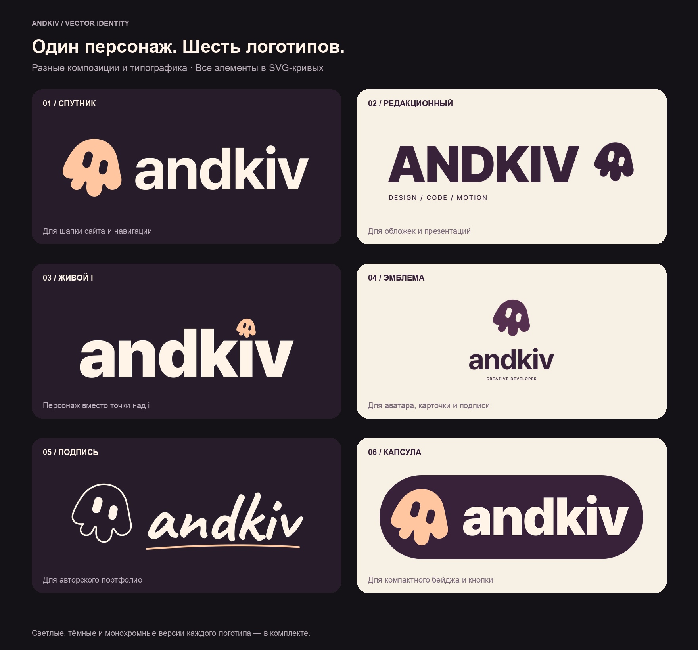
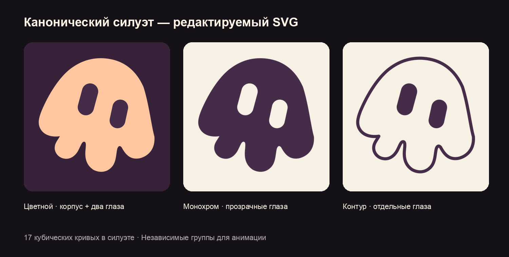
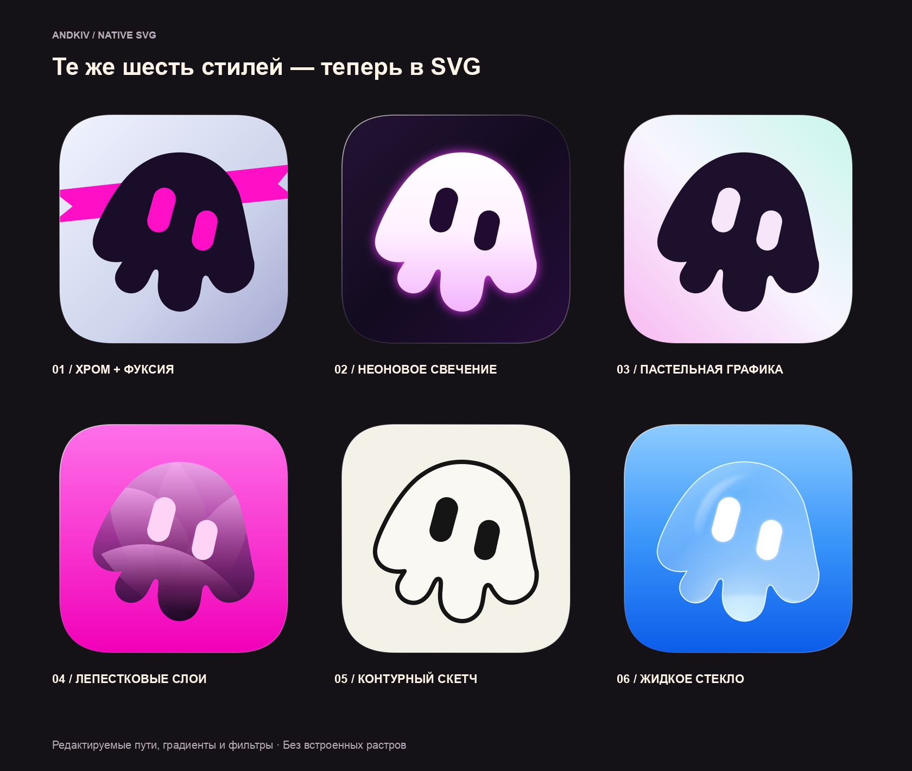

# andkiv — векторный персонаж и шесть логотипов

Набор подготовлен в ветке `codex/kiv-mascot-assets`. Имя бренда — `andkiv`, как в адресе сайта. Имя самого персонажа пока не закреплено.

Выбранные варианты **01, 03, 06** и новый комбинированный **07** собраны отдельно в [selected-logos/](selected-logos/README.md).



## Варианты логотипа

| № | Вариант | Идея и применение |
| --- | --- | --- |
| 01 | Спутник | Персонаж слева и строчная надпись `andkiv`. Основной кандидат для шапки сайта. |
| 02 | Редакционный | Крупный `ANDKIV`, небольшой персонаж справа и подпись `DESIGN / CODE / MOTION`. Для обложек и презентаций. |
| 03 | Живой i | Персонаж заменяет точку над `i`. Для крупного размещения и последующей анимации. |
| 04 | Эмблема | Персонаж над подписью. Вертикальная композиция для карточки, подписи или профиля. |
| 05 | Подпись | Контурный персонаж и рукописный `andkiv`. Личная авторская подача. |
| 06 | Капсула | Контрастная округлая плашка. Для компактного бейджа и отдельного графического элемента. |

Каждый вариант находится в `svg/logos/` в трёх версиях:

- `*-light.svg` — для светлого фона;
- `*-dark.svg` — для тёмного фона;
- `*-mono.svg` — монохром с `currentColor`.

Все надписи переведены в кривые. Для просмотра и размещения готовых SVG установка шрифтов не требуется. Типографика основана на уже используемых в проекте Pretendard и Caveat.

## SVG персонажа



- [Цветной мастер](svg/mascot/mascot.svg) — прозрачный фон, отдельные группы `body`, `eye-left`, `eye-right`.
- [Монохромный знак](svg/mascot/mascot-ink.svg) — `currentColor`, глаза вырезаны из силуэта и прозрачны.
- [Светлый знак](svg/mascot/mascot-light.svg) — для тёмных фонов.
- [Контур](svg/mascot/mascot-outline.svg) — контурный корпус и отдельные глаза.
- [SVG-спрайт](svg/mascot/sprite.svg) — символ `andkiv-mascot`.

Канонический `viewBox` — `0 0 512 512`. Силуэт состоит из 17 кубических кривых Безье. Геометрия и параметры двух глаз сохранены в `source/geometry.json`. Силуэт сверён с выбранным растровым оригиналом; это редактируемые пути, а не встроенный PNG.

Для анимации используется цветной мастер с независимыми группами. В монохромном файле тело и прозрачные глаза объединены в один составной путь.

При использовании SVG через `` внешняя CSS-переменная `color` не передаётся внутрь изображения. Для перекраски `currentColor` используйте inline SVG или спрайт:

```html
<svg width="40" height="40" viewBox="0 0 512 512" style="color: #ffc69f" aria-label="andkiv">
  <use href="./svg/mascot/sprite.svg#andkiv-mascot" />
</svg>
```

## Векторные иконки



В `svg/icons/` находятся выбранная персиково-сливовая иконка и шесть векторных интерпретаций ранее созданных стилей: хром с фуксией, неон, пастель, лепестковые слои, контур и стекло.

Свечение, стекло и полупрозрачные слои воссозданы средствами SVG: градиентами, масками отсечения и фильтрами. Их фактура отличается от сгенерированных растров; форма персонажа общая для всего набора.

В `png/icons/<стиль>/` экспортированы прозрачные PNG: **16, 24, 32, 48, 64, 96, 128, 180, 192, 256, 512, 1024 px**, а также `favicon.ico` с кадрами 16, 32 и 48 px.

## Структура и сборка

- `svg/mascot/` — мастер, монохром, контур и спрайт.
- `svg/logos/` — шесть композиций, по три версии каждой.
- `svg/icons/` — семь иконок.
- `png/icons/` — PNG разных размеров и ICO.
- `previews/logos/` — PNG логотипов шириной 1200 px с прозрачным фоном.
- `previews/` — листы сравнения.
- `source/geometry.json` — каноническая геометрия.
- `source/validation.json` — результаты проверки SVG и соответствия силуэта оригиналу.
- `manifest.json` — перечень файлов и исходных шрифтов.
- `build-assets.py` — воспроизводимая сборка.
- `verify-assets.py` — проверка структуры SVG, экспортов и силуэта.

Для повторной сборки нужны Python 3, Pillow, FontTools с поддержкой WOFF2/Brotli и `rsvg-convert`. Для проверки совпадения силуэта также нужны NumPy и SciPy. Исходные шрифты берутся из репозитория.

```sh
python3 assets/brand/andkiv/build-assets.py
python3 assets/brand/andkiv/verify-assets.py
```

Набор содержит готовые векторные ассеты и предложения по логотипу. Подключение выбранного варианта к интерфейсу сайта — следующий отдельный шаг.
