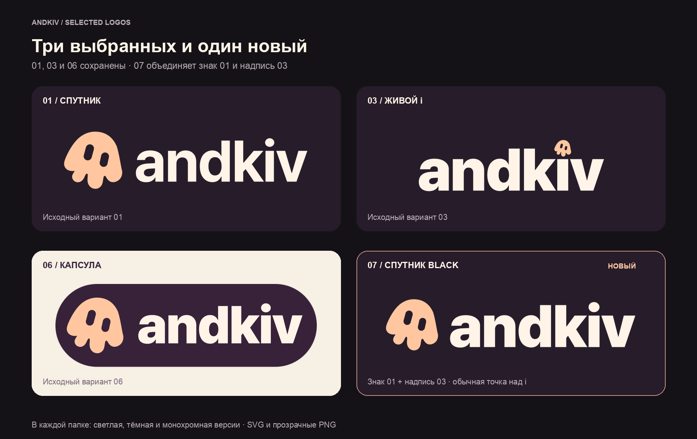

# Выбранные логотипы andkiv

В этой папке сохранены варианты **01, 03 и 06**, а также новый **07**, собранный по запросу.

| Папка | Вариант |
| --- | --- |
| `01-companion/` | Исходный №1: персонаж слева от andkiv. |
| `03-playful-i/` | Исходный №3: персонаж вместо точки над i. |
| `06-capsule/` | Исходный №6: логотип в округлой плашке. |
| `07-companion-black/` | Новый №7: знак слева из №1 и надпись Pretendard Black из №3. Над i — обычная точка. |

В каждой папке находятся `light.svg`, `dark.svg`, `mono.svg` и соответствующие прозрачные PNG шириной 1200 px. SVG полностью в кривых, установка шрифтов для использования не требуется.

Варианты 01, 03 и 06 скопированы без изменений. Для нового варианта сохранены геометрия иконки №1 и начертание, размер букв и межбуквенный интервал №3; восстановлен полный глиф i с обычной точкой.

`manifest.json` содержит состав набора и результаты проверки. Повторная сборка: `python3 assets/brand/andkiv/build-selected-logos.py` из корня репозитория; нужны зависимости основной сборки.
