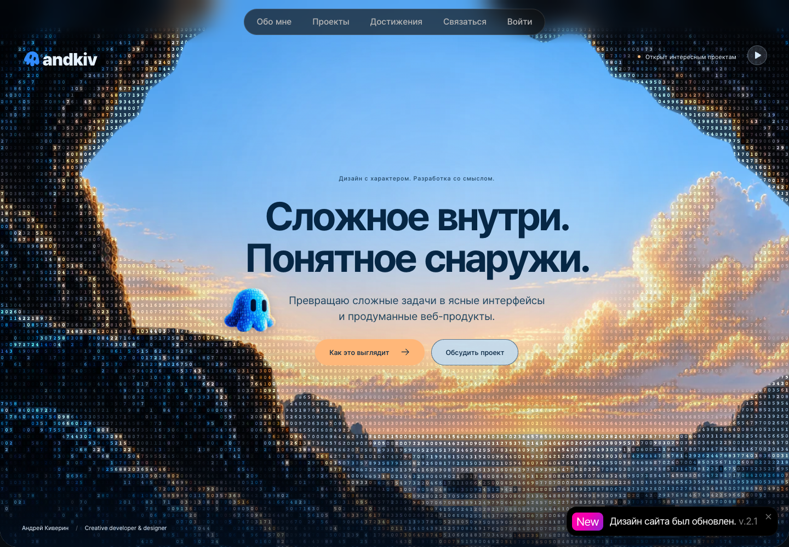
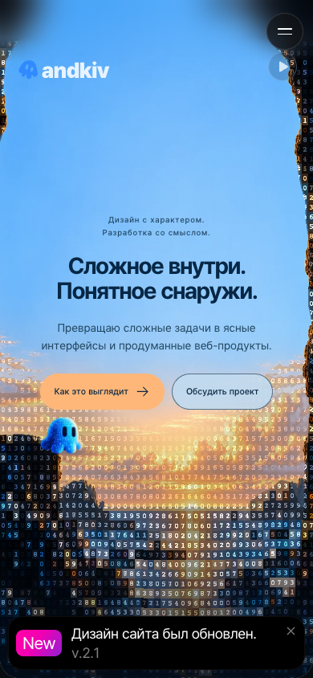

# Проверка маскота и логотипа · 2026-10-24

- Главный маскот заменён на объёмную прозрачную генерацию с ASCII-фактурой по присланному пользователем фрагменту. Встроенный image_gen; исходник и точный промпт сохранены рядом в implementation/.
- Доставка: `src/assets/hero/mascot-ascii-3d.webp`, 512 × 512, с прозрачностью, около 78 КБ. Никаких новых библиотек или дополнительных циклов requestAnimationFrame.
- SVG логотипа №7 проверен сравнением всех значений path d с выбранным оригиналом: геометрия совпадает, изменены только цвета и метаданные.
- Chromium: размеры 1440 × 1000, 768 × 1024, 390 × 844 и 320 × 640. Логотип и маскот загружаются, горизонтального переполнения и пересечения маскота с кнопками нет.
- Кнопка паузы останавливает движение и блик маскота. При prefers-reduced-motion обе анимации отключены.
- Ошибок JavaScript и HTTP при проверке нет.

