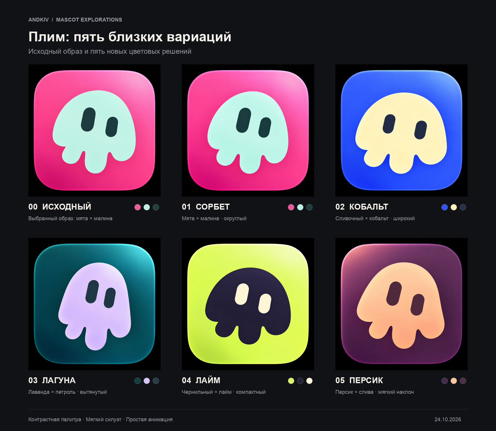

# Плим — пять вариаций выбранного персонажа

Пять новых концептов на основе выбранной пользователем мятной медузы на малиновом фоне. Сохранены мягкий купол, три округлых отростка, два глаза-капсулы и отсутствие мелких деталей. Очков и человеческих черт нет.

| № | Название | Направление |
| --- | --- | --- |
| 1 | Сорбет | Мятный персонаж на малиновом фоне; компактнее и округлее исходного. |
| 2 | Кобальт | Сливочный персонаж на кобальте; широкий низкий купол. |
| 3 | Лагуна | Лавандовый персонаж на тёмном петрольном фоне; вытянутый силуэт. |
| 4 | Лайм | Тёмный персонаж на лаймовой подложке; плотный собранный силуэт. |
| 5 | Персик | Персиковый персонаж на тёмно-сливовом фоне; мягкий наклон и длиннее центральный отросток. |

## Содержимое

- `00-reference.png` — выбранный пользователем исходный образ.
- `concepts/` — пять отдельных исходных сгенерированных PNG.
- `png/<вариант>/` — копии в размерах 16, 32, 48, 64, 128, 256, 512 и 1024 px.
- `contact-sheet.png` — сравнение пяти новых вариантов с исходным.
- `small-sizes.png` — сравнение читаемости при 16, 32, 48, 64 и 128 px.
- `manifest.json` — описания, целевые палитры и пути к файлам.
- `prompts.md` — точные промпты пяти вариаций.

Генерация: встроенный `image_gen`. При сборке превью изображения только уменьшаются и размещаются рядом; дизайн персонажей не редактируется.

Сборка превью: `python3 ../prepare-previews.py .` (нужен Pillow).

PNG разных размеров предназначены для сравнения концептов. Финишная подготовка favicon/PWA, чистого SVG, анимации и логотипа выполняется для выбранного варианта. Это растровые концепты, без имитации вектора через встроенный PNG. HEX в манифесте — целевые значения из промптов; в растровых изображениях есть мягкие оттенки и градиенты.

Для анимации достаточно выделить корпус и два глаза: плавное зависание, мягкое сжатие формы, моргание и перевод взгляда. Неровная высота глаз и небольшой наклон сохраняют характер персонажа.

