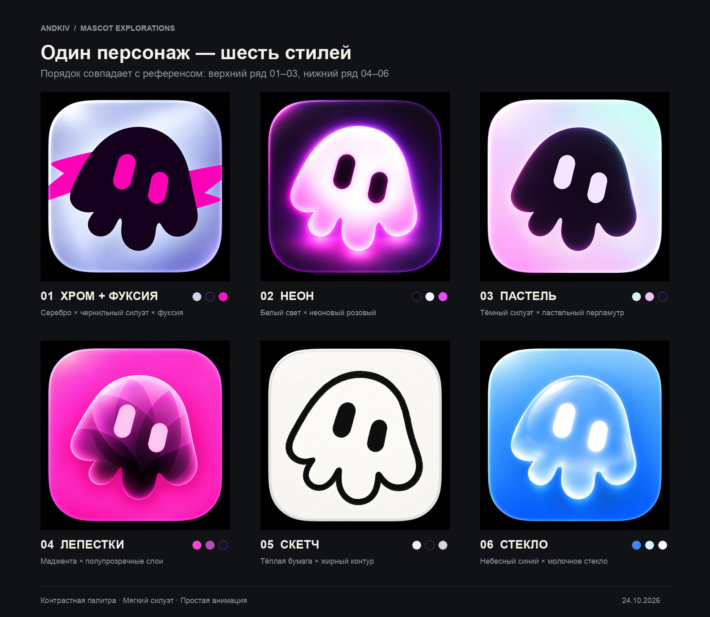

# Выбранный персонаж — шесть стилей

Основа — выбранный пользователем персиковый персонаж на сливовой подложке. Во всех шести версиях сохранены мягкий асимметричный купол, три округлых отростка, положение двух глаз и характерный выступ слева. Оформление следует шести иконкам второго референса в том же порядке.

| № | Стиль | Как перенесён референс |
| --- | --- | --- |
| 01 | Хром + фуксия | Серебристо-сиреневая подложка, тёмный силуэт, фуксиевые глаза и графический росчерк за персонажем. |
| 02 | Неоновое свечение | Молочно-белый корпус, розово-фиолетовое свечение и тёмная сливовая подложка. |
| 03 | Пастельная графика | Тёмный знак на мятно-розовой перламутровой подложке. |
| 04 | Лепестковый градиент | Полупрозрачные перекрывающиеся слои внутри выбранного силуэта на яркой мадженте. |
| 05 | Чёрно-белый скетч | Толстый живой контур, чёрные глаза, тёплая бумажная фактура. |
| 06 | Жидкое стекло | Молочное полупрозрачное стекло, светлые глаза, блики и голубая подложка. |

## Имена

Десять вариантов с объяснениями — в [names.md](names.md). Имя пока не закреплено.

## Файлы

- `character-reference.png` — выбранная пользователем форма.
- `style-reference.png` — референс шести стилей.
- `concepts/` — шесть исходных сгенерированных PNG.
- `png/<вариант>/` — PNG в размерах 16, 32, 48, 64, 128, 256, 512 и 1024 px.
- `contact-sheet.png` — общий лист в порядке стилевого референса.
- `small-sizes.png` — сравнение в малых размерах.
- `manifest.json` — описания и пути.
- `prompts.md` — точные промпты.

Все шесть изображений созданы встроенным `image_gen`. Превью и уменьшенные копии собираются командой `python3 ../prepare-previews.py .` (Python + Pillow), без изменения самих дизайнов.

Это растровые исследования оформления. PNG разных размеров предназначены для сравнения, а не для немедленной подмены favicon. Чистый SVG и логотип подготавливаются для выбранного варианта. Для стекла, свечения и лепестковых слоёв при векторизации потребуются дополнительные градиенты, маски и эффекты; базовую форму и два глаза можно анимировать независимо.

