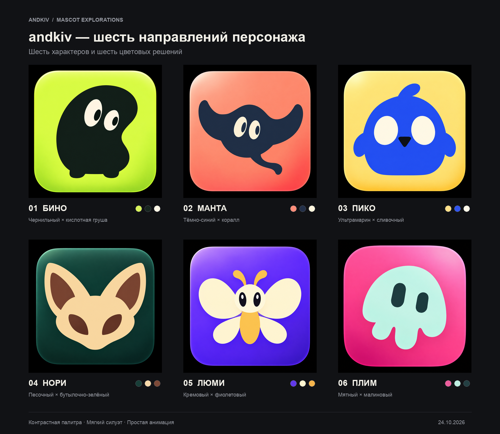

# Персонаж для andkiv — шесть направлений

Создано 24 октября 2026 года в ветке `codex/kiv-mascot-assets`, основанной на актуальном коммите `300b196`.

Это шесть новых концептов после уточнения брифа: без очков, человеческого образа и портретных деталей. Визуальная основа — крупный силуэт, минимум деталей, выразительные глаза и контрастная подложка из приложенных референсов.

| № | Имя | Образ и цвет | Идея движения |
| --- | --- | --- | --- |
| 01 | Бино | Чернильный боб на кислотно-грушевой подложке. | Мягкое покачивание корпуса, моргание и перевод взгляда. Векторная конструкция: корпус, белки глаз, зрачки. |
| 02 | Манта | Мягкий тёмно-синий скат на коралловой подложке. | Плавный взмах крыльями, движение хвоста и моргание. При векторизации крылья и хвост нужно выделить в отдельные группы. |
| 03 | Пико | Ультрамариновый птенец на сливочно-жёлтой подложке. | Короткий наклон корпуса, подпрыгивание, моргание и лёгкое движение крыльев. Клюв остаётся неподвижной опорной формой. |
| 04 | Нори | Песочный фенек на глубокой бутылочно-зелёной подложке. | Поворот головы, покачивание ушей и моргание. Для анимации уши отделяются от общей формы головы. |
| 05 | Люми | Кремовый мотылёк на насыщенной фиолетовой подложке. | Независимые взмахи четырьмя крыльями и лёгкое движение усиков. Корпус и голова остаются спокойными. |
| 06 | Плим | Мятная медуза на малиново-розовой подложке. | Плавное зависание, мягкое сжатие корпуса и моргание. Для первой анимации достаточно корпуса и двух глаз. |

## Файлы

- `concepts/` — шесть исходных сгенерированных PNG.
- `png/<имя>/` — копии в размерах 16, 32, 48, 64, 128, 256, 512 и 1024 px.
- `contact-sheet.png` — общий лист с номерами и целевыми палитрами.
- `small-sizes.png` — сравнение всех шести при 16, 32, 48, 64 и 128 px.
- `manifest.json` — описания, целевые HEX-цвета, пути к файлам и идеи анимации.
- `prompts.md` — точные промпты всех шести генераций.
- `../prepare-previews.py` — воспроизводимая сборка превью и PNG разных размеров; Python + Pillow.

Генерация выполнена встроенным `image_gen`. Сборка общего листа и уменьшенных копий не меняет дизайн персонажей.

Сейчас это растровые концепты для выбора. Размеры PNG позволяют оценить читаемость, но ещё не являются финальным favicon/PWA-набором: декоративные поля и подложку нужно нормализовать для выбранной иконки. Палитры в манифесте — значения из промптов, а не точный замер каждого пикселя.

После выбора направления подготавливаются чистый SVG из редактируемых кривых, раздельные группы для анимации, логотип с `andkiv`, варианты под светлую и тёмную тему и финальный набор иконок. Растр не выдается за SVG и не встраивается внутрь SVG-контейнера.

